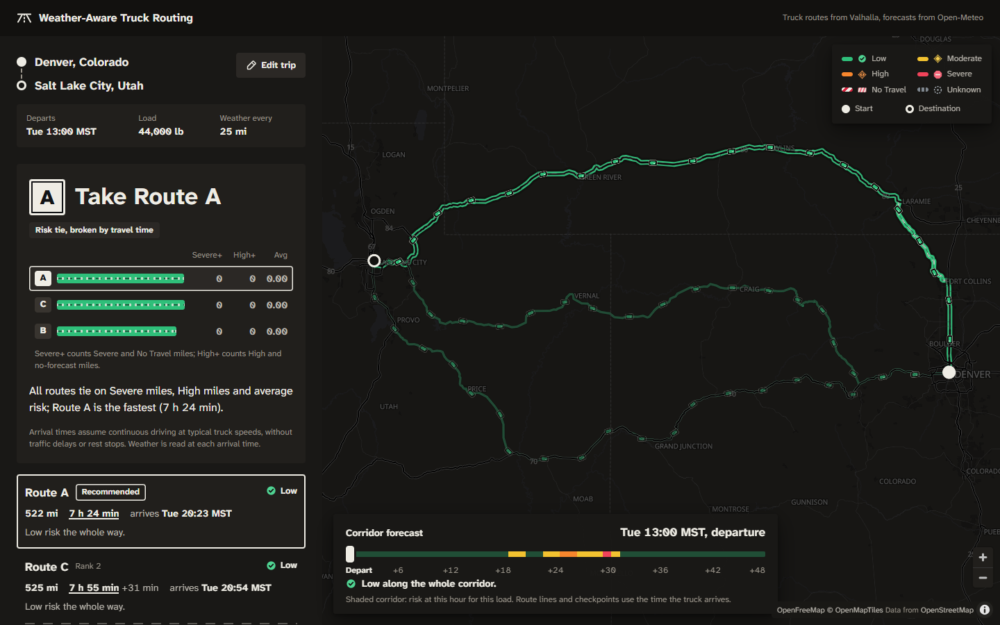

# Weather-Aware Truck Routing

Pick the safest truck route from the weather the truck will actually drive into. Enter a start,
destination, departure time and load weight; the app asks a truck routing engine for three routes,
checks the forecast every 10, 25 or 50 miles **at the time the truck reaches each point**, scores
it with the wind, rain, snow and load rules, and recommends a route with a one-sentence reason.

**Live app:** _add the hosted URL here_ · **Walkthrough:** _add the Loom link here_



## Run it

No API keys are needed: routing, geocoding, weather and map tiles all come from keyless services.
Optionally, put a [Stadia Maps](https://stadiamaps.com) key in `.env` as `STADIA_API_KEY=…` to route
through Stadia's hosted Valhalla, with the public server as automatic fallback (see `.env.example`).

```bash
docker compose up --build          # then open http://localhost:8000
```

Without Docker (Python 3.12, Node 22):

```bash
make install
make dev-api      # Django on :8000
make dev-web      # Vite on :5173 (proxies /api), open http://localhost:5173
make test         # backend + frontend tests
```

`python manage.py analyze_demo` (from `backend/`) runs a live Denver to Salt Lake City analysis
and prints every checkpoint, which is a quick way to check the logic without the UI.

## How it works

1. **Routes.** Valhalla's truck profile returns a route plus two alternates, with the truck's weight
   applied. Near-identical alternates are dropped.
2. **Checkpoints.** Mile 0, every N miles, and the destination. Each gets a position, an ETA
   from the route's cumulative drive time, and the local time zone of that place.
3. **Weather at the ETA.** One batched Open-Meteo request fetches every checkpoint and corridor
   point, snapped to a shared grid, for exactly the hours the trip needs. Wind is interpolated to
   the minute; hourly rain and snow totals come from the hour the truck is in.
4. **Risk.** Each checkpoint is classified with the brief's table and load rules; the worst of
   wind, rain and snow wins, and a sentence says why (`Wind 41.3 mph with 44,000 lb load (> 40,000 lb) → Severe`).
5. **Recommendation.** Fewest Severe miles, then fewest High miles, then lowest average risk,
   then shortest time, exactly as the brief orders them. No-Travel miles count as Severe (they
   are worse), miles with no forecast count as High (a data gap never wins), and the average is
   weighted by distance. The reason names the criterion that decided it and what the choice costs
   against the fastest route; every route card prints the criteria on one shared mile scale.
6. **Map and heatmap.** Routes are drawn as risk-coloured stretches with checkpoint markers and
   popups. The corridor heat holds 49 hourly snapshots (departure to +48 h) for the same load. The
   slider swaps one paint expression per frame and makes **no network requests**.

## Risk rules as implemented

| Level | Wind (mph) | Rain (in/hr) | Snow (in/hr) |
|---|---|---|---|
| Low | < 25 | < 0.10 | < 0.5 |
| Moderate | 25 to < 35 | 0.10 to < 0.25 | 0.5 to < 1.0 |
| High | 35 to < 45 | 0.25 to < 0.50 | 1.0 to < 2.0 |
| Severe | 45 to < 55 | 0.50 to 1.00 | 2.0 to 3.0 |
| No Travel | ≥ 55 | > 1.00 | > 3.0 |

Load rules (wind only, strict `>` on weight, they only raise a level): 45 to 54 mph with more than
30,000 lb is No Travel; 35 to 44 mph with more than 40,000 lb is Severe.

- Values are rounded half-up before comparison (wind 1 dp, precipitation 2 dp).
- Missing forecasts are **Unknown**, never Low.
- Miles per level use midpoint ownership, so they sum to the route length.
- Every interpretation of the brief is listed in [docs/DECISIONS.md](docs/DECISIONS.md).

## Code map

```
backend/trips/domain/      pure rules: risk, sampling, eta, weather (at ETA), miles, ranking, explain, heatmap
backend/trips/providers/   Valhalla, Open-Meteo, Photon adapters + test fakes
backend/trips/services/    analyze() pipeline, caching, time zones
backend/trips/api/         validation, error envelope, response shaping, SPA fallback
frontend/src/features/     trip form + load scale, results, map, heat slider
frontend/src/lib/          time zones, load rules, risk metadata, GeoJSON builders
```

More detail: [architecture](docs/ARCHITECTURE.md) · [API](docs/API.md) · [decisions](docs/DECISIONS.md) · [design system](docs/DESIGN.md).

## Tests

- **Backend, 184 tests (pytest), 96% line coverage (domain rules 97 to 100%):**
  - every threshold boundary and load rule;
  - a Hypothesis property that raising any input never lowers risk;
  - weather-at-ETA semantics, sampling and mile ownership;
  - each ranking criterion deciding once, and the explanation text;
  - provider parsing against a recorded Valhalla response, plus retry and failure handling;
  - end-to-end API contract tests covering partial and total weather outages and validation errors;
  - the ranking rules were also mutation-tested: flipping a strict `>` or dropping a ranking key fails the suite.
- **Frontend, 55 tests (Vitest):** time zone conversion, load rules, GeoJSON building (including reflector bearings and zoomed-out thinning), sample-label placement, the corridor timeline and readout, the later-departure estimate, form validation, risk metadata, route summaries, UI store.
- CI (`.github/workflows/ci.yml`) runs ruff, mypy (strict on the domain), pytest, oxlint, tsc, Vitest and the production build.

## Limitations and next steps

- Continuous driving is assumed; hours-of-service breaks would shift later ETAs.
- Risk uses sustained wind only. Gusts are fetched and returned, but not scored.
- No live traffic; drive times are the routing engine's free-flow estimates.
- Without a Stadia key, routing uses the public Valhalla demo server (fair use). With
  `STADIA_API_KEY` set, Stadia's hosted Valhalla is primary and the public server is the fallback;
  a HERE adapter could sit behind the same `RoutingProvider` protocol.
- The cache is in-process. Several instances would share Redis instead.
- Next features: suggest a better departure window, gust-aware risk, saved trips.

## Credits

Routing: [Valhalla](https://github.com/valhalla/valhalla) on the FOSSGIS public server ·
Weather: [Open-Meteo](https://open-meteo.com) (free for non-commercial use) ·
Geocoding: [Photon](https://photon.komoot.io) · Map: [OpenFreeMap](https://openfreemap.org) and
OpenStreetMap contributors · Type: Atkinson Hyperlegible Next (Braille Institute).
